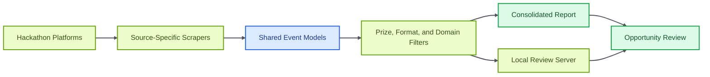

# Hack Search

<p align="center">

  
  
  
</p>

<p align="center">
  <strong>A focused hackathon discovery engine for online and hybrid competitions with cash prizes and strong product or AI relevance.</strong>
</p>

Hack Search collects hackathon listings from several platforms, filters for high-value opportunities, and produces a consolidated report. The project is built for fast discovery where eligibility, format, prize quality, and domain fit matter.

## Core Capabilities

- Scrapes major hackathon platforms through dedicated source adapters.
- Filters events by prize, format, geography, and technology focus.
- Generates structured reports for review and prioritization.
- Includes a lightweight server for local exploration.

## Technical Architecture

Each platform scraper lives behind a dedicated module, with shared models, focus scoring, utility functions, and report generation. This keeps new source integration isolated from filtering and output logic.

## Architecture Diagram



## Technology Stack

- Python scraper pipeline with Requests, BeautifulSoup, and lxml.
- Source adapters for Devfolio, Devpost, DoraHacks, ETHGlobal, MLH, Unstop, and related platforms.
- Report generation layer for consolidated opportunity output.
- Optional server entry point for local browsing.

## Repository Structure

- `scrape.py` - Batch scraping entry point.
- `server.py` - Local server entry point.
- `scrapers/models.py` - Shared event models.
- `scrapers/focus.py` - Relevance and domain-fit logic.
- `scrapers/report.py` - Report generation.
- `requirements.txt` - Python dependencies.

## Getting Started

```bash
python -m venv .venv
source .venv/bin/activate
pip install -r requirements.txt
```

```bash
python scrape.py
```

## Professional Context

This project demonstrates source-specific data engineering, filtering strategy, and practical automation for competitive opportunity discovery.
